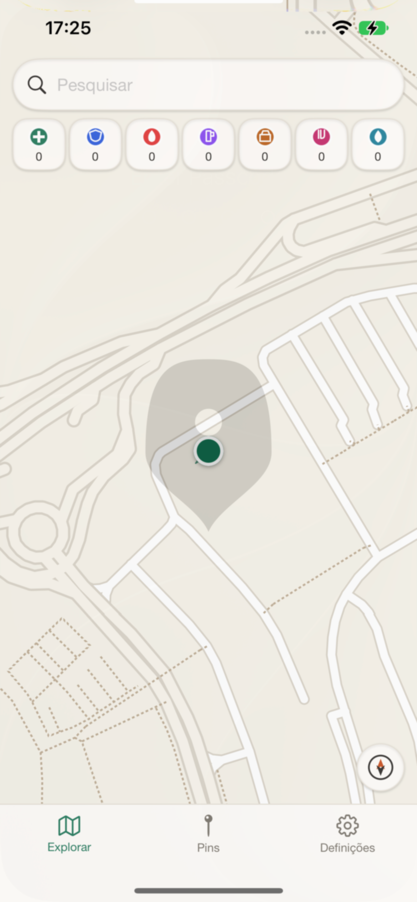

# Blackout Maps

## Offline map

The base map, roads and buildings come with the app. They stay on the phone and do not need a network.

## Services

The map shows health, police, fire, fuel, supermarkets, restaurants and water. Each category keeps its own icon. A category with nothing in view shows nothing. At a wide view, a category in view shows one or two places. Zooming in shows more. A dense area shows every place once the zoom is close.

## Routes

Routes can be on foot, by car or by bicycle.

## Pins

Pins are places you save. You can add one, name it and remove it.

## Directions

During navigation, a map button opens the list of directions from the start of the trip to the destination.

## Position

The app does not use GPS. You set a position on the map. The phone’s motion sensors then keep an approximate position on the device. Sensors can be turned off, and the step length can be changed.

## Catalog

Places, water, addresses and geography download by country or state. Portugal downloads on first launch. Any other place is added from Settings and appears there with its flag and name.

How to add a country or a state: [catalog/README.md](catalog/README.md).
