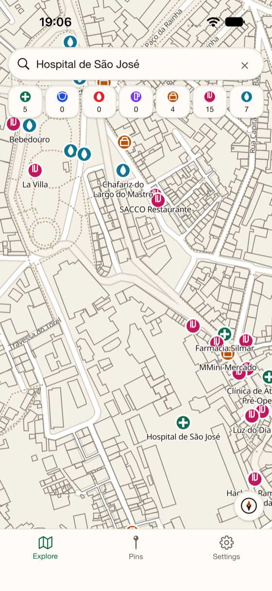
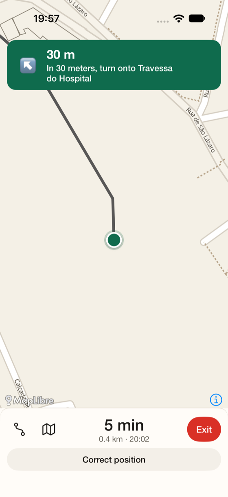
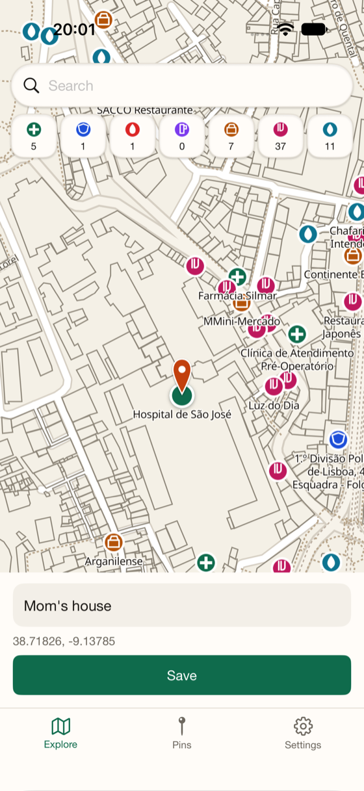

# Blackout Maps

Free offline emergency maps for when the network goes down.

Blackout Maps shows where to find water, medical care, emergency services, fuel and food, and routes you there on foot, by bicycle or by car. Once a country is downloaded, everything works with no network and no GPS. There is no account, no payment and no data collection.

It runs as a web app at [blackoutmaps.com/maps](https://blackoutmaps.com/maps/) and as native apps for Android and iOS.

<p>
  
  
  
</p>

The screenshots are from the iOS app.

## Features

- **Services.** Health, police, fire, fuel, supermarkets and restaurants, each with its own icon and a count of what is in view. A wide view shows one or two places from each category; zooming in shows more.
- **Water.** Drinking fountains, springs, fords, weirs and water access points.
- **Search.** Places, streets, door numbers and services, all searched on the device.
- **Routes.** On foot, by bicycle or by car, with alternatives such as no tolls or no motorways, turn-by-turn directions and the full list of steps.
- **Position without GPS.** You set your position on the map, and the phone's motion sensors keep an approximate position from your steps. You can turn the sensors off and change the step length.
- **Pins.** Save a place, name it and remove it later.
- **Map packages.** Portugal downloads on first launch. Estonia, Latvia, Lithuania, Northern Ireland, Scotland and Wales can be added from Settings, and so can the regions of Belgium, England, Finland, France, Germany, Italy, the Netherlands, Poland and Spain. Every package has the same layers: a basemap with roads, buildings, landuse and labels, plus services, water, addresses, name search and routing.
- **Languages.** The Android app is in English, Portuguese, French, Spanish, German, Arabic, Japanese, Chinese and Russian. The web app is in Portuguese, English, Spanish, French, German and Italian.
- **Privacy.** No login, no tracking, no analytics. Sensor readings stay on the phone.

## Offline use

Everything the map needs is stored on the device, and nothing is sent anywhere.

- **Web app.** A service worker caches the app. The basemap, roads, buildings and data of the chosen package are saved in the browser's private storage (OPFS) on first use. After that, the map opens and routes with no network. Add it to your home screen for the best results. Motion sensors and offline storage need HTTPS.
- **Android and iOS.** The world map and Portugal's basemap, roads and buildings ship inside the app. Every other package downloads from the data repository, [bug-catcher90/blackout-maps-data](https://github.com/bug-catcher90/blackout-maps-data), and stays on the phone. The apps list packages from its [`catalog/index.json`](https://github.com/bug-catcher90/blackout-maps-data/blob/main/catalog/index.json), so a package merged there appears in the web app, Android and iOS with no app change.

Packages are split into parts of 45 MB or less. The apps check each part's SHA-256, resume an interrupted download where it stopped and join the parts on the device.

The network is needed only to download a country.

## Tech stack

| Part | Technology |
| --- | --- |
| Map rendering | [MapLibre GL JS](https://maplibre.org/) on the web, [MapLibre Native](https://github.com/maplibre/maplibre-native) on Android and iOS |
| Basemap | [Protomaps](https://protomaps.com) vector tiles built from [OpenStreetMap](https://www.openstreetmap.org), in a single [PMTiles](https://github.com/protomaps/PMTiles) archive |
| World overview | [Natural Earth](https://www.naturalearthdata.com/) vector tiles (PMTiles) |
| Search, routing, positioning | Plain JavaScript modules in `website/maps/`. Android runs the same engine in V8 through [Javet](https://github.com/caoccao/Javet); iOS runs it in JavaScriptCore (`ios/BlackoutMaps/Resources/engine.js`) |
| Data packages | A Protomaps basemap plus compact binary files (`POI1`, `WTR1`, `ADR1`, `RDG1`, `BLD1`) and gzip JSON, built from OpenStreetMap and published in [blackout-maps-data](https://github.com/bug-catcher90/blackout-maps-data), whose [SPEC.md](https://github.com/bug-catcher90/blackout-maps-data/blob/main/SPEC.md) describes them |
| Web app | Static HTML, CSS and ES modules, no build step, plus a service worker |
| Android | Kotlin, Jetpack Compose, minimum Android 8.0 (API 26) |
| iOS | Swift, SwiftUI, iOS 18 |
| Website | Static pages on [Vercel](https://vercel.com), with serverless functions in `website/api/` for guide checkout ([Stripe](https://stripe.com)) |

## Repository layout

```
website/          blackoutmaps.com (deployed on Vercel with root directory "website")
  maps/           the web app at /maps/
  api/            serverless functions for guide checkout and downloads
android/          Android app (Gradle, Kotlin, Compose)
ios/              iOS app (Xcode, Swift)
  BlackoutMaps/Resources/   shared map assets; Android also packages this folder
catalog/          package entries kept for Android and iOS 1.0, which list this folder (see catalog/README.md)
docs/             docs/android-beta.md, beta signups
```

## Getting started

### Web app

The web app is static, so any HTTP server works:

```bash
cd website
python3 -m http.server 8000
```

Open <http://localhost:8000/maps/>. The first visit downloads the Portugal basemap, so keep the network on until the status says the map is saved.

Motion sensors and home-screen install need HTTPS, or `localhost` on the same device. To run the checkout functions in `website/api/` as well, use `npx vercel dev` from `website/` with your own Stripe test keys in `website/.env.local` (never commit it).

### Android app

Requirements: JDK 17 or newer and the Android SDK with platform 35 (Android Studio provides both).

```bash
cd android
echo "sdk.dir=/path/to/Android/sdk" > local.properties   # Android Studio writes this for you
./gradlew assembleDebug
adb install app/build/outputs/apk/debug/app-debug.apk
```

The build also packages `ios/BlackoutMaps/Resources/` as assets, so keep both folders checked out. Release builds are signed only when a `keystore.properties` file exists outside the repository; see `android/app/build.gradle.kts`.

### iOS app

Open `ios/BlackoutMaps.xcodeproj` in Xcode 16 or newer, let Swift Package Manager fetch MapLibre, choose a team for signing and run the **Blackout Maps** scheme.

## Data sources and attribution

Map data © [OpenStreetMap contributors](https://www.openstreetmap.org/copyright), available under the [Open Database License](https://opendatacommons.org/licenses/odbl/1-0/). The basemap uses [Protomaps](https://protomaps.com), and the world overview is made with [Natural Earth](https://www.naturalearthdata.com/) (public domain).

The apps show "© OpenStreetMap contributors · Protomaps · Natural Earth" on the map at all times, with links. If you build on this project, keep that attribution visible.

[CREDITS.md](CREDITS.md) lists every data source, font and library with its licence.

## Contributing

Contributions are welcome, especially updated service data and new countries. [CONTRIBUTING.md](CONTRIBUTING.md) has the details.

- **Add a country or a region:** map packages live in [bug-catcher90/blackout-maps-data](https://github.com/bug-catcher90/blackout-maps-data). Follow its [CONTRIBUTING.md](https://github.com/bug-catcher90/blackout-maps-data/blob/main/CONTRIBUTING.md): the build script makes every layer, and its validator, which CI runs on every pull request, rejects a package missing any of them.
- **Report a problem with the map data:** wrong or missing places usually come from OpenStreetMap. Fix them at [openstreetmap.org](https://www.openstreetmap.org/fixthemap) so everyone benefits, then open an issue here to refresh the package.
- **Code changes:** open a pull request with a short description and, for anything visible, a screenshot of the web app and, where it applies, of Android or iOS. Test on a phone-width screen in light and dark mode.

Never commit secrets, signing keys or the paid guide PDFs.

## License

The source code is released under the [MIT License](LICENSE).

The map data in this repository (the `.pmtiles`, `.bin.gz` and `geo.json.gz` files) and in [blackout-maps-data](https://github.com/bug-catcher90/blackout-maps-data) is derived from OpenStreetMap and is available under the [ODbL 1.0](https://opendatacommons.org/licenses/odbl/1-0/). Natural Earth data is public domain.

The paid guides, guide pages and images, product photos, embedded videos, and the Blackout Maps name and logo are not covered by the MIT License. See [CREDITS.md](CREDITS.md#content-that-is-not-open).
